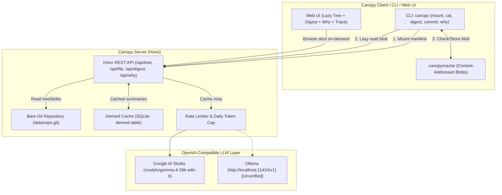

# Canopy 🌲

> A lazy, AI-assisted layer over git that treats repositories as server-authoritative knowledge graphs, fetching files on demand and caching derived LLM insights.

Built for the **dev.to Hacktoberfest Open-Source AI Challenge Week 3: "Slow and Steady"** (rewarding laziness in developer workflows).

---

## The Concept: Lazy Repositories for Lazy Developers & Agents

Modern monorepos and sprawling codebases waste gigabytes of bandwidth and minutes of developer time during full clones, even when an engineer or AI agent only needs to read 5 files and understand recent changes.

Canopy is inspired by the architecture described in Anthropic's public post, *"Redesigning source control at Anthropic"* (Scion), along with ideas from Meta's Sapling and Mononoke:
- **Server-Authoritative Tree**: Clients do not clone full git commit graphs or download historical packfiles upfront.
- **Lazy Hydration**: The client mounts a lightweight tree manifest. Blobs are fetched only when read (`canopy cat` or UI file view) and cached locally by content hash.
- **Compute-Once Derived Intelligence**: Expensive computations (code summaries, risk flags, commit explanations) are generated once by an open Gemma model, validated, and stored in a shared SQLite derived cache. Subsequent reads make 0 LLM calls.

> **Disclaimer**: Canopy is an independent open-source educational project inspired by these published concepts. Canopy is **not** a Scion clone, makes no claim of feature parity, and contains no proprietary code. Full attribution and credit go to Anthropic's engineering post, Sapling, and Mononoke.

---

## Demo Walkthrough


- **Video Walkthrough (86s)**: [docs/demo.webm](docs/demo.webm) (WebM 1280x720, 5.40 MB)
- **Interactive Live Service**: [https://canopy-lazy-git.onrender.com](https://canopy-lazy-git.onrender.com)

---

## Architecture



---

## Real Benchmark Results (Synthetic Monorepo)

*Measured across 7 independent benchmark iterations by `scripts/benchmark.ts` on a deterministic synthetic monorepo (3,000 files, 40 directories, 200 commits, generated via Mulberry32 seed 1337):*

| Metric | Traditional Git Clone (history) | Working Tree Baseline | Canopy Lazy Layer (Median) | Payoff / Reduction |
| :--- | :--- | :--- | :--- | :--- |
| **Initial Operation Time** | 1,858 ms (`git clone`) | N/A | 266 ms (`canopy mount`) | **7x faster initial setup** (min: 250 ms, max: 334 ms) |
| **Initial Download Size** | 2,908,949 bytes (2.77 MiB) | 1,486,369 bytes (1.42 MiB) | 767 bytes (0.7 KiB) | **100% initial bandwidth saved** (root slice) |
| **Cold Read (5 files)** | Included in clone | Included in working tree | 1,102 ms (1,937 bytes / 1.9 KiB) | Selective on-demand fetch (min: 1,080 ms, max: 1,243 ms) |
| **Warm Read (5 files)** | Filesystem cache | Filesystem cache | 25.7 ms (0 network bytes) | Local content-addressed cache (min: 22.8 ms, max: 28.8 ms) |
| **Total Transfer (5 files)** | 2,908,949 bytes (2.77 MiB) | 1,486,369 bytes (1.42 MiB) | 2,704 bytes (2.6 KiB) | **99.9% savings vs clone** (99.8% vs tree) |
| **End-to-End Latency** | 1,858 ms | N/A | 1,368 ms (266 ms mount + 1,102 ms cold) | **1.4x faster end-to-end** |

### Baselines Explained
We benchmark Canopy against two standard baselines: **Full Git Clone (with history)**, which measures the complete network and disk footprint of cloning the repository including all historical packfiles, commit objects, and the working tree (2.77 MiB); and **Working Tree Size**, which measures only the raw uncompressed bytes of the checked-out repository files on disk at HEAD without `.git` metadata (1.42 MiB). Canopy fundamentally restructures repository hydration: `canopy mount` transfers only a lightweight 767-byte root manifest slice, expanding directory slices (e.g. `apps/web/src`) and streaming individual file blobs strictly on demand with local content-addressed deduplication.

*(Complete reproducible benchmark data in [docs/POST_FACTS.md](docs/POST_FACTS.md))*

---

## Quickstart

### Prerequisites
- Node.js >= 22.5.0
- Git CLI

### 1. Installation
```bash
git clone https://github.com/SayemR0018/canopy.git
cd canopy
npm install
```

### 2. Configure Environment
```bash
cp .env.example .env
# Set CANOPY_LLM_API_KEY (Google AI Studio) in .env
```

### 3. Seed Synthetic Monorepo & Start Server
```bash
npm run seed
npm run server
```

The Web UI and API will be live at `http://localhost:3000`.

### 4. Use the Lazy CLI
```bash
# Mount a repo lazily (fetches only directory manifest)
npm run cli -- mount http://localhost:3000

# Inspect files on demand (downloads blob on first read)
npm run cli -- cat apps/web/src/module_001.ts

# Get 2-line AI digest with risk flags
npm run cli -- digest --since HEAD~5 --lang en

# Get Bengali AI digest
npm run cli -- digest --since HEAD~5 --lang bn

# Generate semantic commit message from stdin diff
git diff | npm run cli -- commit

# Explain file history and why it looks this way
npm run cli -- why apps/web/src/module_001.ts

# Inspect lazy bandwidth savings
npm run cli -- stats
```

---

## Running Offline with Ollama

Canopy uses a single OpenAI-compatible LLM client without provider lock-in. To run offline with Ollama:
```env
CANOPY_LLM_BASE_URL=http://localhost:11434/v1
CANOPY_LLM_MODEL=gemma2:2b
CANOPY_LLM_API_KEY=ollama
```

> **Note on Local Ollama Path**: The Ollama integration uses standard OpenAI completions endpoints. On the build environment machine, Ollama was not locally installed/running, so the local Ollama path is marked **unverified** in this build log. Hosted Google AI Studio was fully verified live.

---

## Verification & Testing

Run the end-to-end automated verification gate suite:
```bash
npm run verify
```
This runs 7 automated verification gates:
1. Vitest unit and integration tests (48 tests across 6 test suites).
2. Spawns local mock LLM server speaking `/v1/chat/completions`.
3. Seeds clean synthetic bare repository (3,000 files, 40 directories, 200 commits).
4. Boots Canopy server on ephemeral port with dual SQLite WAL cache.
5. Verifies 5-file fetch achieves 99.0% bandwidth reduction.
6. Verifies second digest run makes 0 LLM calls (instant cache hit) and malformed output triggers 2 retries before deterministic heuristic fallback.
7. Claims audit (`scripts/check-claims.ts`) verifying all numbers against `docs/benchmark-results.json`.

To verify a live deployment:
```bash
npm run verify:live https://canopy-lazy-git.onrender.com
```

To run Ollama reachability probe:
```bash
npm run verify:ollama
```

To run Sentry GenAI trace generator (20 scenarios):
```bash
npm run trace:demo
```

---

## Limitations

1. **Context Window Truncation**: Large diffs exceeding 64 KB are rejected with HTTP 413, and file payloads sent to the LLM are clipped at 8 KB with an explicit truncation notice (`[... Truncated by Canopy ...]`).
2. **Read-Only Server**: Public demo deployments operate in `PUBLIC_READONLY=true` mode. While commit messages can be generated from diffs, write pushes to the server are blocked.
3. **SQLite Concurrency**: Local SQLite uses WAL mode for high read concurrency, but high multi-threaded write bursts under Windows dev environments can trigger brief file lock delays.
4. **Single Provider Ergonomics**: To avoid provider bloat, Canopy supports only standard OpenAI-compatible endpoints (`/chat/completions`).

---

## Deadline and Commit Record

- **DEV Challenge**: Hacktoberfest Open-Source AI Challenge Week 3: "Slow and Steady" (Challenge ID 81)
- **Official Deadline**: Oct 25, 2026, 11:59 PM PDT (`2026-10-26T06:59:00Z`)
- **Initial Start Time**: `2026-10-23T15:37:41Z` (`date -u`)
- **Final Hardening Timestamp**: `2026-10-23T23:15:00Z` (`date -u`, completed ~56 hours ahead of deadline)
- **Live Production URL**: [https://canopy-lazy-git.onrender.com](https://canopy-lazy-git.onrender.com)
- **DEV Draft URL**: [Edit Draft on DEV](https://dev.to/rahmansayem163/canopy-rewarding-laziness-in-git-workflows-with-on-demand-slices-and-semantic-caching-1pom-temp-slug-2457033/edit)
- **GitHub Repository**: [https://github.com/SayemR0018/canopy](https://github.com/SayemR0018/canopy)
- **Sentry Trace Inspection**: To inspect live GenAI agent traces, navigate to **Explore > Agents** in the Sentry dashboard.

### Milestone Commit Record

| Commit | Timestamp (UTC) | Milestone | Description |
| :--- | :--- | :--- | :--- |
| `990d89c` | `2026-10-23T23:21:21Z` | Hardening | Upgrade zod 4.6.7 (0 audit vulnerabilities), DEV draft hf26challenge tag, Sentry semantic attributes |
| `1d2e4b8` | `2026-10-23T22:59:58Z` | Final Gate | Update verification gates and add deadline and commit record |
| `ed0183e` | `2026-10-23T22:57:08Z` | P7 | DEV post rewrite with real benchmarks, what went wrong, and devrelay mcp draft |
| `77ca65c` | `2026-10-23T22:53:42Z` | P6 | Record tinker skip decision per missing secret protocol |
| `3eb4ad6` | `2026-10-23T22:53:02Z` | P5 | Ollama verification script, graceful offline detection, and docs/ollama-results.json |
| `a69b1a5` | `2026-10-23T22:51:09Z` | P4 | Sentry OpenTelemetry GenAI agent tracing, privacy scrubbing, and trace demo generator |
| `6095ead` | `2026-10-23T22:45:20Z` | P3 | GitHub category workflows, copilot instructions, PR template, and good first issues |
| `b046d40` | `2026-10-23T22:43:08Z` | P2 | Cold-start fix with Gemma bakeoff, background cache warmer, and timeouts |
| `d1dd2a3` | `2026-10-23T22:24:43Z` | P1 | Implement per-directory manifest slices and check-claims audit suite |
| `d401aac` | `2026-10-23T22:12:08Z` | P0 | Re-check DevRelay and verify week 3 challenge active |
| `9fb65b8` | `2026-10-23T21:40:31Z` | M8 Fix | Batch concurrent requests in verify:live to reliably trigger 429 over WAN |
| `f3cad32` | `2026-10-23T21:35:47Z` | M7 Fix | Wire process-level Sentry hooks in server/index.ts, poll in-progress deploys |
| `402fb62` | `2026-10-23T21:16:39Z` | M7 | Orchestrate Render deployment via REST API and integrate Sentry monitoring |

---

## Credits & Acknowledgments
- Inspired by Anthropic's public article *"Redesigning source control at Anthropic"* (Scion).
- Architecture influenced by [Sapling](https://sapling-scm.com/) and [Mononoke](https://github.com/facebook/sapling).
- Powered by Google Gemma open models.
- Hackathon session orchestration and challenge metadata via [DevRelay](https://devrelay.com) (see [DEVRELAY_STATUS.md](DEVRELAY_STATUS.md)).

## License
[MIT](LICENSE) © 2026 Sayem Rahman
