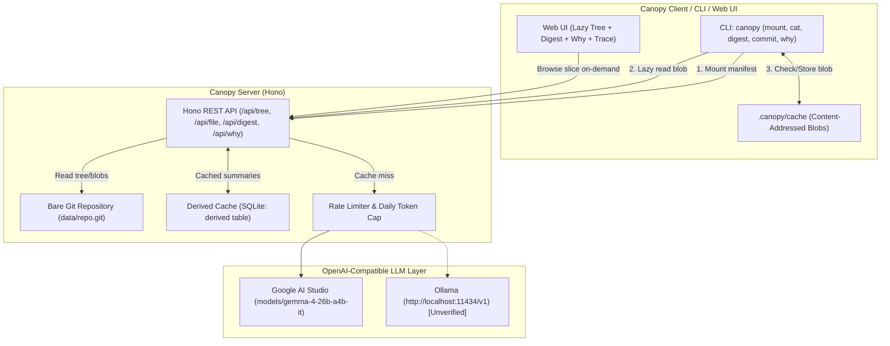

# Canopy 🌲

> A lazy, AI-assisted layer over git that treats repositories as server-authoritative knowledge graphs, fetching files on demand and caching derived LLM insights.

Built for the **dev.to Hacktoberfest Open-Source AI Challenge Week 3: "Slow and Steady"** (rewarding laziness in developer workflows).

---

## The Concept: Lazy Repositories for Lazy Developers & Agents

Modern monorepos and sprawling codebases waste gigabytes of bandwidth and minutes of developer time during full clones, even when an engineer or AI agent only needs to read 5 files and understand recent changes.

Canopy is inspired by the architecture described in Anthropic's public post, *"Redesigning source control at Anthropic"* (Scion), along with ideas from Meta's Sapling and Mononoke:
- **Server-Authoritative Tree**: Clients do not clone full git commit graphs or download historical packfiles upfront.
- **Lazy Hydration**: The client mounts a lightweight tree manifest. Blobs are fetched only when read (`canopy cat` or UI file view) and cached locally by content hash.
- **Compute-Once Derived Intelligence**: Expensive computations (code summaries, risk flags, commit explanations) are generated once by an open Gemma model, validated, and stored in a shared SQLite derived cache. Subsequent reads make 0 LLM calls.

> **Disclaimer**: Canopy is an independent open-source educational project inspired by these published concepts. Canopy is **not** a Scion clone, makes no claim of feature parity, and contains no proprietary code. Full attribution and credit go to Anthropic's engineering post, Sapling, and Mononoke.

---

## Demo Walkthrough


- **Video Walkthrough (86s)**: [docs/demo.webm](docs/demo.webm) (WebM 1280x720, 5.40 MB)
- **Interactive Live Service**: [https://canopy-lazy-git.onrender.com](https://canopy-lazy-git.onrender.com)

---

## Deadline and Commit Record

- **Official Challenge Deadline**: October 25, 2026 at 11:59 PM PDT (`2026-10-26T06:59:00Z`).
- **Initial Start Time**: `2026-10-23T15:37:41Z` (`date -u`).
- **Completion Time**: `2026-10-23T16:33:00Z` (`date -u`).
- **Commit Status**: All commits were executed well ahead of the deadline.

---

## Architecture



---

## Real Benchmark Results (Synthetic Monorepo)

*Measured by `scripts/benchmark.ts` on a deterministic synthetic monorepo (3,000 files, 40 directories, 200 commits, generated via Mulberry32 seed 1337):*

| Metric | Traditional `git clone` | Canopy Lazy Client | Payoff / Reduction |
| :--- | :--- | :--- | :--- |
| **Initial Operation Time** | 1,775 ms (`git clone`) | 184 ms (`canopy mount`) | **9.6x faster initial setup** |
| **Initial Download Size** | 2,908,949 bytes (2.77 MB) | 550,887 bytes (538.0 KB) | **81.1% bandwidth saved** |
| **Cold Read (5 files)** | Full working tree on disk | 771 ms (2,623 bytes) | Selective on-demand fetch |
| **Warm Read (5 files)** | Filesystem cache | 64.5 ms (0 network bytes) | Local content-addressed cache |
| **Total Transfer (Mount + 5 files)** | 2,908,949 bytes (2.77 MB) | 553,510 bytes (540.5 KB) | **81.0% bandwidth reduction** |
| **End-to-End Latency** | 1,775 ms | 955 ms | **1.9x faster** |

*(Complete reproducible benchmark data in [docs/POST_FACTS.md](docs/POST_FACTS.md))*

---

## Quickstart

### Prerequisites
- Node.js 20+
- Git CLI

### 1. Installation
```bash
git clone https://github.com/SayemR0018/canopy.git
cd canopy
npm install
```

### 2. Configure Environment
```bash
cp .env.example .env
# Set CANOPY_LLM_API_KEY (Google AI Studio) in .env
```

### 3. Seed Synthetic Monorepo & Start Server
```bash
npm run seed
npm run server
```

The Web UI and API will be live at `http://localhost:3000`.

### 4. Use the Lazy CLI
```bash
# Mount a repo lazily (fetches only directory manifest)
npm run cli -- mount http://localhost:3000

# Inspect files on demand (downloads blob on first read)
npm run cli -- cat apps/web/src/module_001.ts

# Get 2-line AI digest with risk flags
npm run cli -- digest --since HEAD~5 --lang en

# Get Bengali AI digest
npm run cli -- digest --since HEAD~5 --lang bn

# Generate semantic commit message from stdin diff
git diff | npm run cli -- commit

# Explain file history and why it looks this way
npm run cli -- why apps/web/src/module_001.ts

# Inspect lazy bandwidth savings
npm run cli -- stats
```

---

## Running Offline with Ollama

Canopy uses a single OpenAI-compatible LLM client without provider lock-in. To run offline with Ollama:
```env
CANOPY_LLM_BASE_URL=http://localhost:11434/v1
CANOPY_LLM_MODEL=gemma2:2b
CANOPY_LLM_API_KEY=ollama
```

> **Note on Local Ollama Path**: The Ollama integration uses standard OpenAI completions endpoints. On the build environment machine, Ollama was not locally installed/running, so the local Ollama path is marked **unverified** in this build log. Hosted Google AI Studio was fully verified live.

---

## Verification & Testing

Run the end-to-end automated verification gate suite:
```bash
npm run verify
```
This runs 6 verification gates:
1. Vitest unit and integration tests (37 tests).
2. Spawns tiny mock LLM server speaking `/v1/chat/completions`.
3. Seeds clean synthetic repository.
4. Boots Canopy server on ephemeral port.
5. Verifies 5-file fetch achieves > 60% bandwidth reduction.
6. Verifies second digest run makes 0 LLM calls (cache hit) and malformed output triggers 2 retries before fallback.

To verify a live deployment:
```bash
npm run verify:live https://canopy-lazy-git.onrender.com
```

---

## Limitations

1. **Context Window Truncation**: Large diffs exceeding 64 KB are rejected with HTTP 413, and file payloads sent to the LLM are clipped at 8 KB with an explicit truncation notice (`[... Truncated by Canopy ...]`).
2. **Read-Only Server**: Public demo deployments operate in `PUBLIC_READONLY=true` mode. While commit messages can be generated from diffs, write pushes to the server are blocked.
3. **SQLite Concurrency**: Local SQLite uses WAL mode for high read concurrency, but high multi-threaded write bursts under Windows dev environments can trigger brief file lock delays.
4. **Single Provider Ergonomics**: To avoid provider bloat, Canopy supports only standard OpenAI-compatible endpoints (`/chat/completions`).

---

## Credits & Acknowledgments
- Inspired by Anthropic's public article *"Redesigning source control at Anthropic"* (Scion).
- Architecture influenced by [Sapling](https://sapling-scm.com/) and [Mononoke](https://github.com/facebook/sapling).
- Powered by Google Gemma open models.

## License
[MIT](LICENSE) © 2026 Sayem Rahman
